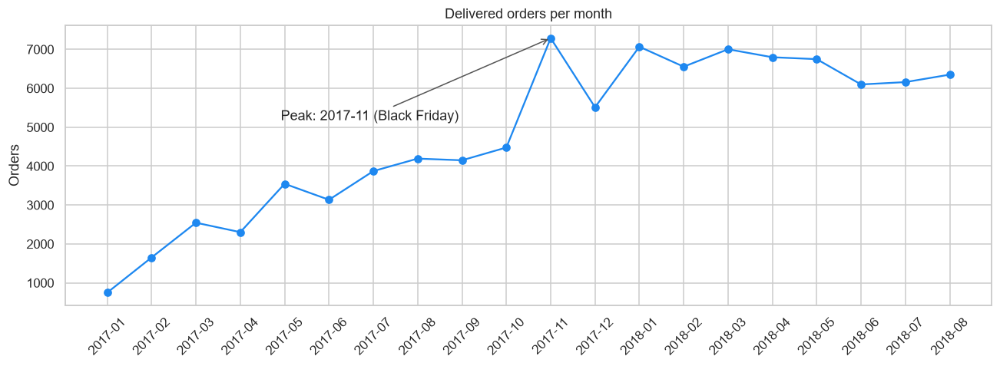
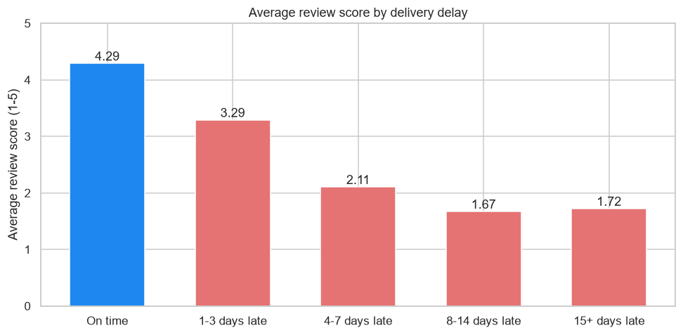
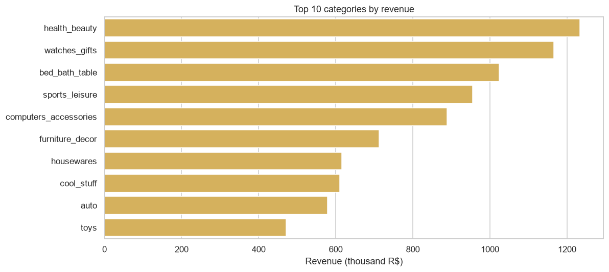

# 📊 E-Commerce Business Performance Analysis (Olist Dataset)

## 📌 Project Overview
This project provides a comprehensive analysis of the Brazilian E-Commerce public dataset by **Olist** (~100k orders, 2016-2018).
The goal is to analyze sales performance, identify seasonal trends, and evaluate customer satisfaction to provide actionable business insights.

---

## 🛠️ Methodology (CRISP-DM)
This project follows the **CRISP-DM** (Cross-Industry Standard Process for Data Mining) framework:
1.  **Business Understanding**: focus on sales volume, growth drivers and customer satisfaction.
2.  **Data Understanding**: exploration of a relational database (9 tables).
3.  **Data Preparation**: delivered orders only, joins between orders, items, products, reviews and customers, datetime formatting.
4.  **Exploratory Data Analysis (EDA)**: temporal analysis, Pareto distribution, delivery delay vs. satisfaction, geography.

---

## 🔑 Key Business Questions
- What is the monthly sales trend?
- Which product categories dominate sales?
- Is there a correlation between delivery delays and customer satisfaction scores?
- Where are the customers located?

---

## 📈 Key Insights
Scope: **96,478 delivered orders**, R$ 13.2M of product revenue.

- **Growth & seasonality**: revenue for Jan-Aug 2018 is **+141%** vs Jan-Aug 2017. Orders peak in **November 2017** (7,289 orders, **+63% vs October**), driven by **Black Friday**: 1,147 orders on 24 Nov 2017 vs a median of 183 per day that month.
- **Top categories (Pareto)**: out of 72 categories, **8 categories (11%) generate 50% of revenue**, and the **top 20% of categories account for 74%** of revenue. Leaders: health & beauty, watches & gifts, bed/bath/table, sports & leisure.
- **Customer satisfaction**: only 6.7% of orders are delivered late, but they score **2.27/5 on average vs 4.29/5** for on-time orders. **62% of late orders get a 1-2 star review** (vs 9% on time): late delivery is the strongest driver of bad reviews.
- **Geography**: São Paulo state (SP) alone generates **38% of revenue**; the top 3 states reach 63%.







---

## 💡 Recommendations
1. **Prepare for November**: plan stock, logistics capacity and marketing budget ahead of Black Friday.
2. **Focus on leading categories**: prioritize seller acquisition and promotions where revenue is concentrated.
3. **Fix late deliveries first**: more reliable delivery estimates and monitoring of late sellers/carriers are the most direct lever on customer satisfaction.
4. **Grow beyond São Paulo**: strengthen logistics in the South-East and test regional campaigns in other states.

---

## 🚀 Technical Stack
- **Language**: Python 3
- **Libraries**: `Pandas` (data manipulation), `Matplotlib` & `Seaborn` (visualization)
- **Environment**: Jupyter Notebook

---

## 📂 Project Structure
```text
├── data/                       # Olist CSV files (not versioned, download from Kaggle)
├── notebooks/
│   └── olist_analysis.ipynb    # Main analysis notebook
├── output/
│   └── visualizations/         # Exported charts
├── requirements.txt
└── README.md
```

## 🔗 How to run
1. Clone this repository.
2. Install the dependencies: `pip install -r requirements.txt`.
3. Download the data from [Kaggle](https://www.kaggle.com/datasets/olistbr/brazilian-ecommerce) and put the CSV files in `data/`.
4. Run the notebook `notebooks/olist_analysis.ipynb`.

## 👨‍💻 Author
Youssef Achou, [Synerbyte Technologies](https://synerbyte.eu) · [LinkedIn](https://www.linkedin.com/in/youssef-achou-5218a83b9)
